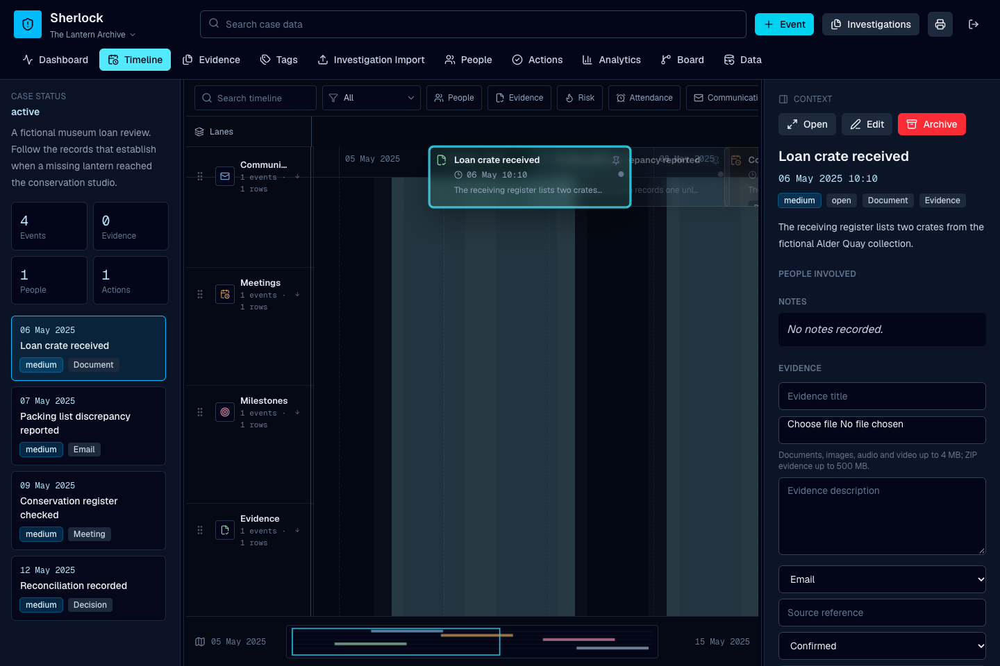

# Sherlock Timeline

Sherlock Timeline helps one investigator reconstruct a sequence of events from correspondence, documents and decisions. Select a timeline entry to see its date, linked people, evidence and follow-up actions.



## Explore the workspace

| View | What you can do |
| --- | --- |
| Timeline | Search and filter events, change zoom, and inspect the material behind a decision. |
| Investigation Import | Preview extracted information from supported documents or correspondence, review it, then approve the import. |
| Evidence and Tags | Attach source material, link it to events and organise it with case-specific tags. |
| People and Board | Record participants and explore relationships between people and events. |
| Actions and Analytics | Track follow-ups and review gaps in a chronology. |

## Run the fictional case locally

Use Node.js 24, pnpm 10.34.5 and Docker Compose. Run the commands from the project root.

1. Install dependencies and generate unique local credentials. Enter and save a unique administrator password when prompted. Input is hidden. It writes a private `.env` and refuses to overwrite an existing one.

   ```sh
   pnpm install --frozen-lockfile
   node scripts/init-local.mjs
   ```

2. Start PostgreSQL on loopback, apply the schema and load the demonstration.

   ```sh
   docker compose up -d --wait postgres
   pnpm prisma generate
   pnpm prisma migrate deploy
   pnpm seed
   ```

3. Start the application and sign in at [localhost:3000](http://localhost:3000).

   ```sh
   pnpm dev --hostname 127.0.0.1
   ```

Open **Timeline** in **The Lantern Archive** and select **Conservation register checked** to see the registrar's part in reconciling a museum loan. The seed is optional, accepts only a loopback database named `sherlock_demo`, and leaves an existing demonstration case intact. To start with an empty workspace, omit the seed step.

## Architecture and data

| Component | Responsibility |
| --- | --- |
| Next.js App Router and React | Render the dashboard and interactive timeline. Route handlers process case changes, imports, evidence and reports. |
| Prisma and PostgreSQL | Store case records, evidence metadata, relationships and actions. Versioned migrations live in `prisma/migrations`. |
| File storage | Development writes ordinary attachments to ignored local storage. Production mode requires a private Blob store for evidence bytes. Large ZIPs use direct Blob uploads. |
| Session boundary | One administrator can access the whole installation. The server checks a signed cookie before serving the workspace, API and downloads. |

The repository contains fictional demonstration records. Supply live records through the application or a private import. Keep databases, evidence, exports, local backups and credentials outside version control. A case export contains sensitive record contents and may contain storage references. Recovery of a complete installation requires both database and evidence-store backups.

The default local workflow uses Docker for PostgreSQL and runs Next.js in development mode. The optional application container runs in production mode and needs private Blob configuration for file operations. A Vercel build applies database migrations, so give every preview its own database and private storage. Use a trusted device for investigations because timeline preferences and annotations can persist in the browser.

## Development checks

```sh
pnpm lint
pnpm typecheck
pnpm test
pnpm build
pnpm audit
```

GitHub Actions checks the full Git history for secrets, installs the locked dependencies, migrates a disposable PostgreSQL database, loads the demo, and runs the checks above. The workflow needs no deployment credentials.

## Further reading

- [Administrator configuration](AUTHENTICATION.md)
- [Timeline rendering and keyboard navigation](docs/timeline-architecture.md)
- [Evidence storage and recovery](docs/evidence-storage.md)
- [Case export format](docs/case-export-format.md)
- [Third-party software and notices](THIRD_PARTY_NOTICES.md)

## Licence

Original project code is available under the [MIT licence](LICENSE). Bundled fonts, icons and dependencies retain their [own notices](THIRD_PARTY_NOTICES.md).
